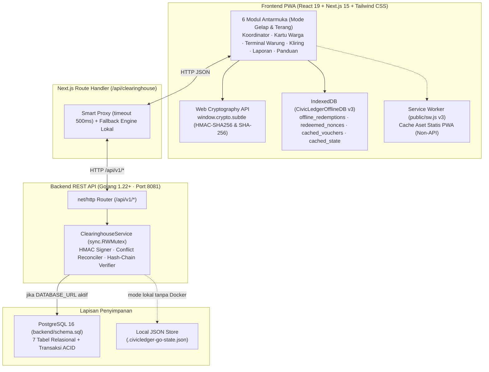
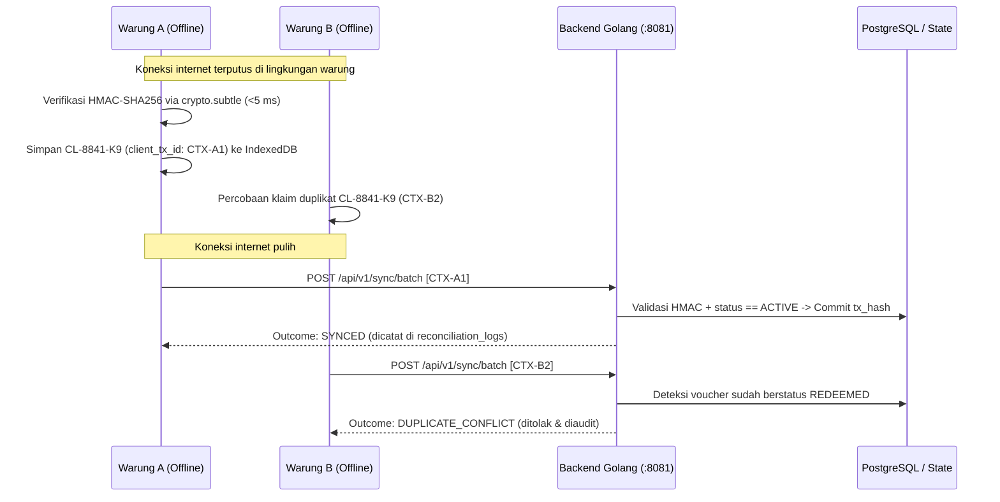
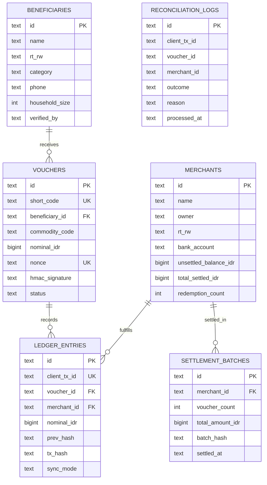

# Dokumentasi Teknis & Panduan Sistem — CivicLedger

**Nama Proyek:** CivicLedger: Resilient Local Voucher Clearinghouse for Community Mutual Aid  
**Kompetisi:** STACK 2026 by GDGoC ITB — *Case 2: Stronger Communities and Everyday Services*  
**Tim:** `Run.exe` — Amos Belsing Arta Baringbing (Ketua), Jessica Ruth, Jonathan Pasaribu  
**Repositori:** https://github.com/amos-kureiju/CivicLedger  
**Versi:** `1.2.0` (Prototipe Semifinal)

---

## 1. Gambaran Umum Sistem

**CivicLedger** adalah aplikasi web progresif (*Progressive Web Application* / PWA) berarsitektur **offline-first** yang dilengkapi backend **Golang** dan basis data **PostgreSQL** untuk mengelola distribusi, verifikasi, penukaran, dan audit voucher bantuan pangan komunitas (tingkat RT/RW, relawan, dan warung kelontong lokal).

### Masalah yang Diselesaikan
- **Pencatatan manual terpecah:** Kupon kertas dan spreadsheet rentan hilang, sulit direkap, serta lambat diaudit.
- **Klaim ganda (*double spending*):** Kupon manual mudah digandakan atau ditukar lebih dari sekali.
- **Ketergantungan sinyal & mesin EDC:** Warung kelontong di gang padat sering mengalami putus sinyal seluler dan tidak memiliki mesin EDC perbankan.
- **Inklusivitas warga rentan:** Sebagian warga lansia tidak memiliki smartphone (merujuk Survei APJII 2025: 19,34% penduduk Indonesia belum terhubung internet, 43,62% karena tidak memiliki perangkat dan 40,77% karena kendala literasi digital).

### Solusi Inti CivicLedger
1. Voucher terkunci pada **paket komoditas pangan pokok** (non-tunai) dan ditandatangani dengan **HMAC-SHA256** + `nonce` sekali pakai.
2. Penyajian voucher dua jalur: **Dynamic QR Code** (smartphone) dan **Kode Alfanumerik 6-karakter** via SMS/cetak (non-smartphone/lansia).
3. Verifikasi **100% offline** di browser HP warung melalui **Web Cryptography API (`window.crypto.subtle`)** dan penyimpanan antrean di **IndexedDB**.
4. Sinkronisasi batch dengan **rekonsiliasi konflik di sisi server Golang** menggunakan `client_tx_id` unik.
5. Pencatatan permanen pada **buku besar berantai hash SHA-256** (*tamper-evident*), pencairan batch simulasi, dan ekspor laporan **CSV/JSON**.

---

## 2. Arsitektur Sistem

### 2.1 Diagram Arsitektur Menyeluruh



### 2.2 Alur Sinkronisasi Offline & Rekonsiliasi Konflik



---

## 3. Struktur Direktori & Penjelasan File

```text
CivicLedger/
├── backend/
│   ├── main.go                  # REST API Golang, domain logic, HMAC-SHA256, rekonsiliasi & PostgreSQL/JSON store
│   ├── main_test.go             # 3 suite unit test otomatis (anti-double-spend, konflik batch, registrasi merchant)
│   ├── schema.sql               # Skema 7 tabel PostgreSQL 16 + indeks
│   ├── Dockerfile               # Multi-stage Docker build untuk binary Golang
│   ├── go.mod / go.sum          # Dependensi Go (stdlib + github.com/lib/pq)
├── public/
│   ├── guides/                  # 5 foto panduan editorial untuk halaman Panduan Pengguna
│   │   ├── guide-1-organizer.jpg
│   │   ├── guide-2-beneficiary.jpg
│   │   ├── guide-3-merchant.jpg
│   │   ├── guide-4-clearinghouse.jpg
│   │   └── guide-5-reports.jpg
│   ├── icon.svg                 # Ikon PWA monokrom CivicLedger
│   ├── manifest.json            # Web App Manifest (installable PWA)
│   └── sw.js                    # Service Worker v3 (cache aset statis, melewati /api/)
├── src/
│   ├── app/
│   │   ├── api/clearinghouse/
│   │   │   └── route.ts         # Proxy Next.js ke Golang (:8081) + fallback lokal otomatis
│   │   ├── globals.css          # Konfigurasi Tailwind, scrollbar & aturan cetak (print CSS)
│   │   ├── layout.tsx           # Root layout, font Inter & JetBrains Mono, pelindung error ekstensi Chrome
│   │   └── page.tsx             # Aplikasi utama 6 tab, sidebar rail, sakelar Online/Offline & Gelap/Terang
│   ├── components/
│   │   ├── ReportsComplianceTab.tsx  # Tab 5: KPI analitik, grafik komoditas/warung, ekspor CSV/JSON & kepatuhan
│   │   └── UserGuideTab.tsx          # Tab 6: Panduan fitur interaktif dengan 5 foto + lightbox & navigasi cepat
│   └── lib/
│       ├── types.ts             # Definisi tipe TypeScript bersama (Beneficiary, Merchant, Voucher, Ledger, dll.)
│       ├── crypto.ts            # Web Crypto API (HMAC-SHA256, SHA-256, QR payload encoder/decoder, chain verifier)
│       ├── indexeddb.ts         # Wrapper IndexedDB v3 (antrean offline, nonce terpakai, cache voucher & full state)
│       ├── client-seed.ts       # Seed cadangan sisi browser jika boot offline pertama tanpa server
│       └── server-ledger.ts     # Engine fallback lokal Next.js & verifikasi rantai hash Node.js
├── docs/
│   └── DOCUMENTATION.md         # Dokumen ini
├── docker-compose.yml           # Orkestrasi PostgreSQL 16 + Backend Golang (:8081)
├── package.json                 # Script npm & dependensi frontend
├── tailwind.config.ts           # Konfigurasi Tailwind (darkMode: "class" + font variables)
└── README.md                    # Ringkasan repositori & pengungkapan STACK 2026
```

---

## 4. Dokumentasi Fitur Antarmuka (6 Tab + Kontrol Global)

### 4.1 Kontrol Global (Sidebar Kiri & Bar Atas)
- **Mode Koneksi (`Online` / `Offline`):** Mensimulasikan kondisi putus sinyal di warung. Saat `Offline`, penerbitan voucher baru dibatasi, namun pemindaian & penukaran di **Terminal Warung** tetap berjalan penuh menggunakan `crypto.subtle` dan `IndexedDB`.
- **Tampilan (`Gelap` / `Terang`):** Tersimpan di `localStorage` (`civicledger_theme`). Mode **Terang** berkontras tinggi dirancang khusus untuk keterbacaan layar HP pemilik warung di ruang terbuka dan warga lansia.
- **Indikator Mesin & Simpanan:** Menampilkan engine aktif (`Go API · PostgreSQL`, `Go API · Lokal`, atau `Next.js Lokal`) serta status `IndexedDB · SW`.
- **Tombol `Sinkron Antrean (N)`:** Muncul otomatis di bar atas saat ada transaksi offline menunggu rekonsiliasi.
- **Lencana `Data Demo Sintetis`:** Penanda transparansi wajib sesuai aturan STACK 2026.
- **Tombol `Reset Data Sintetis`:** Membersihkan seluruh object store IndexedDB dan mengembalikan server ke data demo awal.

### 4.2 Tab 1 — `Konsol Koordinator`
- **Bar Metrik 4 KPI:** Menampilkan *Saldo Kas Bantuan*, *Voucher Aktif*, *Omzet Warung Lokal*, dan *Direktori Terverifikasi* (termasuk jumlah anomali diblokir).
- **Registrasi Cepat (`+ Warga` & `+ Warung`):** Menambahkan keluarga penerima manfaat baru (`WGA-xxxx`) atau warung mitra baru (`WRG-xx`) tanpa berpindah halaman.
- **Form `Terbitkan Voucher`:** Memilih penerima manfaat, 1 dari 4 paket komoditas pangan terkunci (`PKG-BERAS-5KG`, `PKG-PROTEIN-01`, `PKG-DAPUR-02`, `PKG-DARURAT-FULL`), dan masa berlaku (`24 Jam`, `72 Jam`, `7 Hari`).
- **Registri Alokasi Voucher:** Pencarian teks bebas, filter status (`Semua`, `Aktif`, `Ditukar`, `Cair`), serta tombol pintasan **`Kartu`** (buka di Tab 2) dan **`Tukar`** (buka di Tab 3).

### 4.3 Tab 2 — `Kartu Warga`
- Memilih profil warga dan menampilkan seluruh voucher yang diterbitkan kepadanya.
- **Kartu Voucher QR Dinamis:** QR code selalu dirender hitam (`#09090b`) di atas latar putih bersih agar mudah dipindai kamera HP murah.
- **Kode SMS / Cetak 6-Karakter:** Format `CL-xxxx-xx` untuk warga lansia/non-smartphone.
- **Aksi Inklusif:** `Salin Slip SMS`, `Cetak Slip` (memanfaatkan `@media print` bersih), dan `Buka di Terminal Warung`.

### 4.4 Tab 3 — `Terminal Warung` (POS Offline-First)
- Memilih **Warung Aktif** beserta saldo tertahan (*Menunggu Cair*).
- **3 Metode Input:** `Pindai Kamera` (mendukung deteksi QR otomatis `BarcodeDetector API` pada Chrome/Edge), `Pilih Cepat Voucher` (untuk demo 1 perangkat), dan input manual `Kode Alfanumerik`.
- **3 Tombol Verifikasi & Uji Keamanan:**
  1. `Verifikasi HMAC-SHA256 & Tukar` — validasi kriptografi lokal + commit online/offline.
  2. `Uji Manipulasi Payload` — mengubah nominal voucher menjadi `Rp 500.000` untuk membuktikan penolakan otomatis oleh `HMAC-SHA256` bahkan saat offline.
  3. `Simulasi Konflik Offline` — memasukkan klaim duplikat dari perangkat warung ke-2 ke `IndexedDB` untuk menguji rekonsiliasi server.
- **Panel `Verifikator Web Crypto`:** Menampilkan bukti langsung `ID_TX_KLIEN`, `PAYLOAD_KANONIS`, `SIG_VOUCHER`, `HASIL_HMAC`, `STATUS_NONCE`, `STRUK_SHA256`, dan latensi (ms).
- **Panel `Antrean Offline (IndexedDB)` & `Hasil Rekonsiliasi Server Terbaru`:** Menampilkan antrean tertunda, tombol `Sinkron & Rekonsiliasi Batch`, dan status hasil tiap item (`SYNCED` vs `DUPLICATE_CONFLICT`).

### 4.5 Tab 4 — `Kliring & Buku Besar`
- **Antrean Pencairan Warung Mitra:** Tombol `Cairkan Warung` per warung atau `Cairkan Semua` untuk menghasilkan batch pencairan ber-hash `SHA-256` (jalur transfer simulasi).
- **Buku Besar Audit Berantai Hash SHA-256:** Menampilkan rantai `P` (`prev_hash`) → `C` (`tx_hash`) untuk setiap penukaran.
- **Tombol `Verifikasi Integritas Rantai`:** Melakukan verifikasi ganda di **server Golang** (`GET /api/v1/ledger/verify`) dan **browser WebCrypto** (`verifyLedgerChainWebCrypto`).
- **Log Audit Rekonsiliasi & Struk Batch Pencairan:** Mencatat seluruh riwayat rekonsiliasi offline serta tanda terima batch pencairan.

### 4.6 Tab 5 — `Laporan & Audit`
- KPI analitik (*Tingkat Penukaran*, *Sinkron Offline/Online*, *Anomali Diblokir*, *Omzet Warung Lokal*).
- Grafik batang monokrom **Alokasi per Paket Komoditas** dan **Omzet & Pencairan Warung Mitra**.
- Tombol **`Ekspor CSV`** (siap dibuka di Excel/Google Sheets) dan **`Audit JSON`** (arsip audit lengkap).
- Kartu **Arsitektur Sistem & Keterbukaan Ruang Lingkup** (prototipe selesai vs. simulasi/keterbatasan vs. 3 tugas Final Day).

### 4.7 Tab 6 — `Panduan Pengguna`
- Panduan visual interaktif untuk seluruh 5 fitur utama lengkap dengan **5 foto panduan editorial**, fitur **Perbesar (*Lightbox*)**, filter per langkah, dan tombol **`Buka Fitur ↗`**.

---

## 5. Desain Kriptografi & Penyimpanan Offline

### 5.1 Format Pesan Kanonis & HMAC-SHA256
Setiap voucher menghasilkan tanda tangan kriptografi dari string kanonis berikut:
```text
{voucher_id}|{beneficiary_id}|{commodity_code}|{nominal_idr}|{nonce}|{expires_at}
```
Tanda tangan dihitung memakai **HMAC-SHA256** (`crypto/hmac` di Golang, `crypto.createHmac` di Node.js, dan `window.crypto.subtle` di browser). Perubahan sekecil 1 digit pada nominal atau komoditas langsung menyebabkan ketidaksesuaian tanda tangan.

### 5.2 Rantai Hash Buku Besar (SHA-256 Hash Chain)
Blok pertama merujuk pada genesis hash 64 karakter nol (`0000...0000`). Setiap transaksi berikutnya membentuk hash:
```text
tx_hash = SHA256(prev_hash | voucher_id | merchant_id | nominal_idr | timestamp | hmac_signature)
```

### 5.3 Skema IndexedDB (`CivicLedgerOfflineDB`, Versi `3`)
Dikelola di [src/lib/indexeddb.ts](file:///c:/PA2/CivicLedger/src/lib/indexeddb.ts) dengan 4 *object store*:
1. `offline_redemptions` (`keyPath: "queue_id"`): Antrean penukaran offline beserta `client_tx_id` unik dan `local_receipt_hash`.
2. `redeemed_nonces` (`keyPath: "voucher_id"`): Registri lokal anti-double-spend agar voucher yang sama tidak bisa ditebus dua kali di perangkat yang sama saat offline.
3. `cached_vouchers` (`keyPath: "id"`): Salinan voucher terakhir untuk pencocokan kode pendek 6-karakter saat offline.
4. `cached_state` (`keyPath: "key"`): Snapshot lengkap state kliring (warga, warung, katalog komoditas, buku besar, log rekonsiliasi, batch pencairan) agar antarmuka tetap terisi penuh meskipun dibuka tanpa jaringan.

---

## 6. Referensi REST API

### 6.1 Endpoint Backend Golang (`http://localhost:8081`)

| Method | Endpoint | Deskripsi | Status Kode |
| :--- | :--- | :--- | :--- |
| `GET` | `/api/v1/health` | Cek status server & engine aktif (`GO_LOCAL` / `GO_POSTGRES`) | `200` |
| `GET` | `/api/v1/state` | Ambil seluruh snapshot state kliring | `200` |
| `GET` | `/api/v1/ledger/verify` | Verifikasi integritas rantai hash SHA-256 dari genesis ke head | `200` |
| `POST` | `/api/v1/beneficiaries` | Daftarkan warga penerima manfaat baru | `201`, `400` |
| `POST` | `/api/v1/merchants` | Daftarkan warung mitra lokal baru | `201`, `400` |
| `POST` | `/api/v1/vouchers/issue` | Terbitkan & tandatangani voucher baru | `201`, `400` |
| `POST` | `/api/v1/vouchers/redeem` | Validasi HMAC, cek anti-double-spend, commit ke buku besar | `200`, `403`, `404`, `409`, `410` |
| `POST` | `/api/v1/sync/batch` | Rekonsiliasi antrean penukaran offline (`SYNCED` / `CONFLICT`) | `200`, `400` |
| `POST` | `/api/v1/settlements` | Buat batch pencairan dana untuk 1 atau semua warung | `200`, `400` |
| `POST` | `/api/v1/reset` | Kembalikan seluruh state ke data sintetis awal | `200` |

### 6.2 Contoh Request & Response Penting

**Terbitkan Voucher (`POST /api/v1/vouchers/issue`):**
```json
{
  "beneficiary_id": "WGA-0401",
  "commodity_code": "PKG-BERAS-5KG",
  "validity_hours": 72
}
```

**Sinkronisasi & Rekonsiliasi Batch Offline (`POST /api/v1/sync/batch`):**
```json
{
  "redemptions": [
    {
      "client_tx_id": "CTX-M8A1-9F2B",
      "voucher_id": "VCH-2026-8841",
      "short_code": "CL-8841-K9",
      "merchant_id": "WRG-01",
      "merchant_name": "Warung Kelontong Berkah Bu Yati",
      "hmac_signature": "<64-char hex>",
      "redeemed_at": "2026-11-23T08:15:00Z"
    }
  ]
}
```

### 6.3 Proxy Next.js (`/api/clearinghouse`)
Frontend memanggil `GET /api/clearinghouse`, `GET /api/clearinghouse?op=verify_chain`, dan `POST /api/clearinghouse` dengan field `action` (`ISSUE_VOUCHER`, `ADD_BENEFICIARY`, `ADD_MERCHANT`, `REDEEM_VOUCHER`, `BATCH_SYNC`, `SETTLE_MERCHANTS`, `RESET_DEMO`). Proxy meneruskan ke `GO_BACKEND_URL` (default `http://127.0.0.1:8081`, timeout `500 ms`), dan otomatis menggunakan fallback lokal Next.js jika server Go belum menyala.

---

## 7. Skema Basis Data PostgreSQL (`backend/schema.sql`)



Tabel tambahan: `system_config` menyimpan `pool_total_idr` dan `fraud_blocked_count`.

---

## 8. Panduan Menjalankan & Pengujian

### 8.1 Prasyarat
- **Node.js** `>= 20` & **npm**
- **Go** `>= 1.22` (teruji pada Go `1.25.7`)
- **Docker Desktop** *(opsional, khusus untuk menjalankan PostgreSQL 16)*

### 8.2 Variabel Lingkungan (*Environment Variables*)
| Variabel | Default | Keterangan |
| :--- | :--- | :--- |
| `PORT` | `8081` | Port server REST API Golang |
| `DATABASE_URL` | *(kosong)* | DSN PostgreSQL (kosong = otomatis pakai penyimpanan JSON lokal) |
| `CIVICLEDGER_HMAC_SECRET` | `CIVICLEDGER_RT04_RW08_COBLONG_HMAC_SECRET_2026` | Kunci HMAC-SHA256 prototipe |
| `GO_BACKEND_URL` | `http://127.0.0.1:8081` | Target proxy backend Go dari Next.js |

> **Keamanan:** Jangan pernah menaruh kredensial produksi atau file `.env` ke dalam commit Git (sudah diblokir melalui `.gitignore`).

### 8.3 Menjalankan Mode Lokal (Golang + Next.js)
```powershell
# Terminal 1 — Backend Golang (:8081)
cd backend
go run .

# Terminal 2 — Frontend Next.js PWA (:3000)
npm install
npm run dev
```
Buka `http://localhost:3000`.

### 8.4 Menjalankan Mode Penuh (Docker PostgreSQL 16 + Golang + Next.js)
```powershell
# Terminal 1 — PostgreSQL 16 + Go API
docker compose up --build

# Terminal 2 — Frontend Next.js PWA
npm run dev
```

### 8.5 Menjalankan Pengujian Otomatis
```powershell
# Unit test backend Golang (anti-double-spend, HMAC tamper, konflik batch, registrasi merchant)
cd backend
go test -v ./...

# Pengecekan tipe TypeScript (aman dijalankan saat npm run dev aktif)
npx tsc --noEmit

# Build produksi Next.js (pastikan npm run dev dihentikan terlebih dahulu)
npm run build
```

### 8.6 Pemecahan Masalah Umum (*Troubleshooting*)
- **Error `EADDRINUSE` (`:3000`) atau `bind :8081`:** Sudah ada proses server lain di port tersebut. Hentikan terminal lama (`Ctrl + C`) sebelum menjalankan ulang.
- **Error `Cannot find module './xxx.js'` di Next.js:** Muncul jika `npm run build` dijalankan saat `npm run dev` masih menyala. Hentikan `npm run dev`, hapus folder `.next`, lalu jalankan `npm run dev` kembali.
- **Data lama masih muncul setelah update:** Tekan `Ctrl + Shift + R` (*Hard Refresh*) lalu klik **`Reset Data Sintetis`** di pojok kiri bawah sidebar.

---

## 9. Keterbatasan Prototipe & Peta Jalan Final Day

### Simulasi & Keterbatasan Saat Ini
- **Data Sintetis:** Seluruh profil warga (`WGA-0401`–`WGA-0404`) dan warung (`WRG-01`–`WRG-03`) merupakan data demonstrasi sintetis.
- **Jalur Pencairan Simulasi:** Pencairan dana warung menghasilkan tanda terima hash `SHA-256` tanpa terhubung ke API perbankan BI-FAST / QRIS nyata.
- **Kunci Rahasia Bersama (HMAC):** Browser warung saat ini memverifikasi tanda tangan menggunakan kunci HMAC bersama tingkat RW.

### 3 Tugas Substantif yang Direncanakan untuk Final Day
1. **Verifikasi Asimetris Ed25519:** Mengganti kunci bersama HMAC-SHA256 menjadi tanda tangan privat di server dan verifikasi kunci publik Ed25519 di browser warung.
2. **Autentikasi JWT & Otorisasi Perangkat Warung:** Menambahkan login berbasis peran untuk koordinator serta pendaftaran/pencabutan perangkat warung resmi.
3. **Integrasi Webhook SMS & Penyempurnaan UX Lapangan:** Pengiriman slip voucher SMS otomatis dan perbaikan keterbacaan berdasarkan umpan balik uji coba warga/warung.
